# ITMS 564 Lab01: Identity Lifecycle Management on AWS


## Part A: Run the Tests Locally

All files checked out, and every test passed (256 unit, 13 integration).

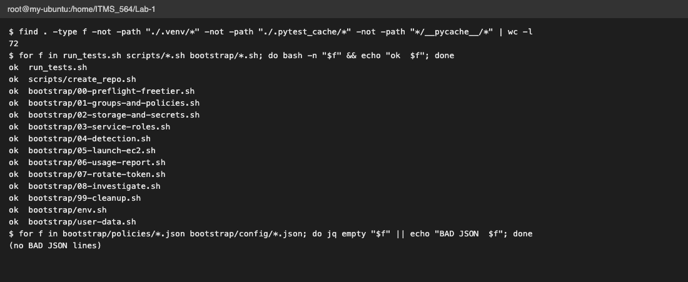
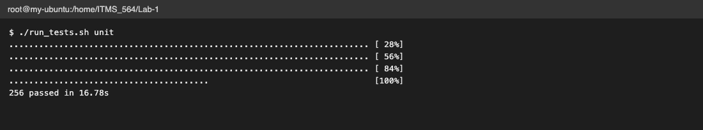
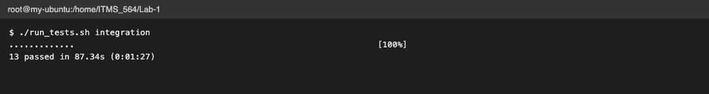

**Q1 (explore). Tests as security controls. Your tests state security facts that must stay true, such as the launch script never opening port 22 and the onboarding role attaching only the MFA guard. Explain where in a delivery pipeline you would run them so that a bad change cannot reach production, and name two kinds of problem they cannot catch. Compare them with policy as code and analysis tools (for example IAM Access Analyzer policy validation, cfn-guard or Open Policy Agent) and with a secret scanner like the credential check in create_repo.sh.**

I'd make them a required check before any change can be merged, and run them again right before deploying. They can't catch changes someone makes by hand in AWS later, and they can't catch wrong assumptions about how AWS works. My own run showed that: every test passed, but the alert emails never came. Tools like Access Analyzer check policies against AWS's own rules, so they catch mistakes I didn't think to test for [1]. A secret scanner just makes sure no passwords or keys get committed. I'd use all three.

## Part B: IAM Groups and Policies

The script created the three groups, each with its policy.

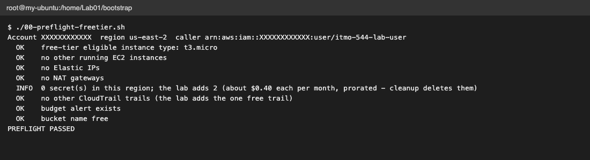
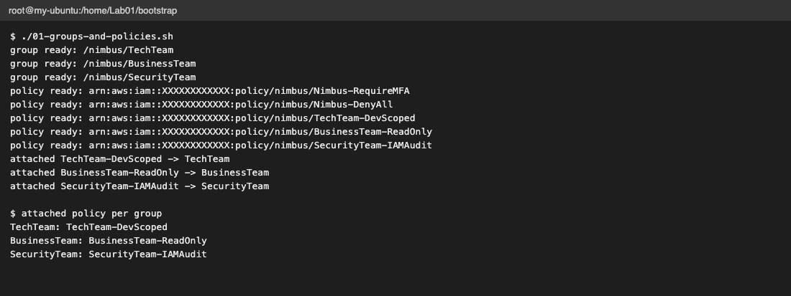

**Q2. Why does Nimbus-RequireMFA use BoolIfExists rather than Bool?**

Some requests, like ones made with access keys, don't say anything about MFA at all. With `Bool`, those would skip the block. `BoolIfExists` blocks them too.

**Q3. In TechTeam-DevScoped, why is a Deny still useful when no Allow grants IAM access?**

It's a safety net. If someone later gives developers a broader policy by mistake, the Deny still wins, because a Deny always beats an Allow.

**Q4 (explore). Group membership as an escalation path. The onboarding role may add users to any group under the /nimbus/ path. If an attacker took over the onboarding service, which of your three groups would be the most valuable to join, and what could the new user then do? Compare a permissions boundary, a Condition on the group name, and a Service Control Policy as ways to close this gap, and say which you would choose.**

SecurityTeam, because its members can edit the company's own policies. An attacker could rewrite them to give themselves full access, or break the offboarding kill switch. A permissions boundary caps what any new user can do, but it has to be set on each one [2]. A rule that only lets the onboarding role add people to TechTeam and BusinessTeam is the simplest fix. A Service Control Policy works, but it needs AWS Organizations and is overkill for one app [3]. I'd use the group-name rule.

## Part C: Buckets, Secrets and Data Protection

Both buckets are private with versioning, and both secrets and log groups exist.

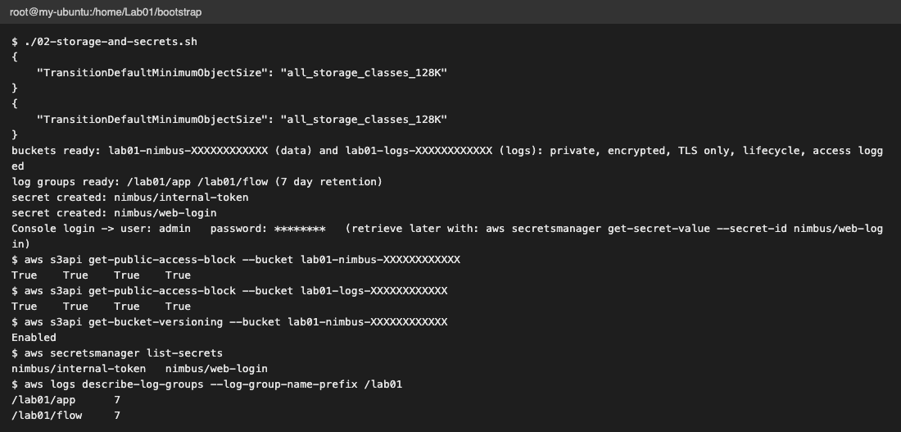

**Q5. Name three places the admin password could have ended up if you had not used Secrets Manager. Why is each one worse?**

1. **In the code on GitHub.** My repo is public, and git keeps it forever, even if I delete it later.
2. **In the server's startup script.** Anyone who can view the instance's settings can read it.
3. **In the container settings.** It shows up when someone inspects the container, and sometimes in logs.

Secrets Manager keeps it encrypted, lets only specific roles read it, records every read and lets me change it easily.

**Q6. What does the TLS only bucket policy stop that Block Public Access does not?**

Block Public Access keeps strangers out. The TLS-only policy also blocks people who are allowed in, if they connect without encryption. I tested it in G5: even my own account got denied over plain HTTP.

**Q7 (explore). Customer managed keys. The lab uses the default encryption keys (SSE-S3 and the default Secrets Manager key) to stay free. Which threats does a customer managed KMS key address that default encryption does not? Describe how a key policy would separate the people who administer the key from the people and roles who use it, and what the extra cost and failure modes are.**

With my own key, reading the data takes two permissions instead of one: access to the bucket and access to the key. If someone gets bucket access by mistake, they still can't read anything. I can also switch the key off to lock all the data at once, and every use is logged. The key policy would let admins manage the key but not use it, and let the app's roles use it but not manage it [4]. It costs about $1 a month per key. The risk is that if the key is turned off or deleted, the data can't be read.

## Part D: One IAM Role per Microservice

The script created six roles, and all three permission tests matched the manual.

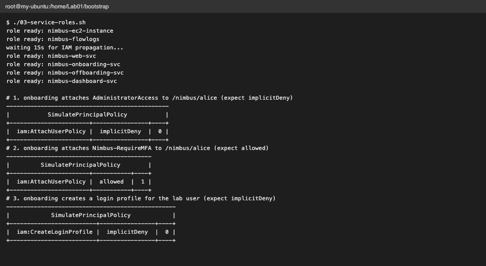

**Q8. For each of the three simulator results, name the Principal, Action, Resource and Request context, and say which statement decided it.**

| Test | Who | Tried to | On | Detail | Result |
|---|---|---|---|---|---|
| 1 | Onboarding role | Attach a policy | alice | AdministratorAccess | **Denied.** `AttachOnlyTheMFAGuardPolicy` only allows the MFA guard. |
| 2 | Onboarding role | Attach a policy | alice | Nimbus-RequireMFA | **Allowed** by `AttachOnlyTheMFAGuardPolicy`. |
| 3 | Onboarding role | Create a console login | my lab user | none | **Denied.** `CreateAndTagNimbusUsersOnly` only covers users under `/nimbus/`. |

**Q9 (explore). Four containers, one host. All four containers share one instance, so a compromised container could assume any service role. Explain how the hop limit of 2 and the instance role make that possible. Then compare three redesigns (one instance per service, container task roles on Amazon ECS, and pod level identity on Kubernetes) on isolation, cost and operational effort.**

The hop limit of 2 lets every container reach the server's credentials [5], and those credentials can become any of the four service roles. So if the web container is hacked, it can act as the onboarding service.

- **One server per service:** the safest option, but four times the cost and upkeep.
- **ECS task roles:** each container only gets its own role [6]. It's safe and affordable, but I'd have to learn ECS.
- **Kubernetes pod identity:** the same idea [7], but the most work and an extra monthly fee.

I'd go with ECS.

## Part E: Logging and Alerts

The trail and both alert rules were created, and I confirmed the email subscription. But **no alert email ever arrived**, and I tracked down why (see Q10).

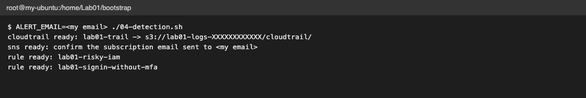
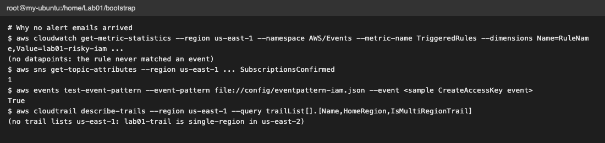

**Q10. Which two kinds of event does the lab alert on, and why alert on them instead of only storing them?**

It alerts on risky IAM changes, like creating access keys or granting admin rights, and on console sign-ins without MFA. Logs only help if someone reads them, and an alert gets a person looking within minutes. In my run, though, the alerts never fired. The trail only recorded events in us-east-2, but IAM alerts happen in us-east-1, so the rules never saw anything. Recording all regions would fix it at no extra cost.

**Q11 (explore). Blind spots in detection. The two EventBridge rules cover a short list of events. Name two attacker actions against IAM that these rules would miss (for example creating a login profile for an existing user, or using stolen credentials from an unusual location). Write the event pattern for one of them, and discuss alert fatigue and how a managed service such as Amazon GuardDuty approaches the same problem.**

They'd miss someone setting a new console password on an existing user, and someone using stolen keys from a strange location. They also miss anything outside us-east-1, which I found out firsthand [8]. A pattern for the password one:

```json
{"source": ["aws.iam"], "detail": {"eventName": ["CreateLoginProfile", "UpdateLoginProfile"]}}
```

My onboarding service does this for every new hire, though, so I'd need to leave it out or I'd get an email every time and start ignoring them. That's alert fatigue. GuardDuty learns what normal looks like and only flags unusual behavior, so I don't have to write every rule myself [9].

## Part F: Launch the Hardened Server

The server came up, the certificate fingerprint matched, and the usage report showed one small server and two secrets.

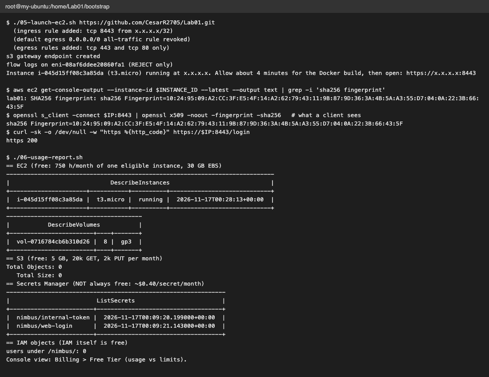

**Q12. Why is there no SSH and no key pair, and how do you debug the server without them?**

No SSH means there's no login for anyone to break into and no key to lose. I debugged it from the server's console output, which showed the fingerprint and the "ready" message, and from the app logs in CloudWatch.

**Q13. If the web container were compromised, what does egress filtering stop and what does it not stop?**

It stops the server from talking out on any port except the two web ports, so an attacker can't open a connection on some other port. It even blocked the server's own clock sync. It doesn't stop data being sent out over normal HTTPS, or someone using stolen AWS credentials, since both use the allowed port.

**Q14 (explore). Certificates and trust on first use. The console uses a self signed certificate and you compared its fingerprint by hand. Explain the attack this comparison defends against and why most users skip it. Compare this with a certificate from AWS Certificate Manager behind a load balancer, and with a public certificate authority. What do HSTS and certificate transparency add?**

Comparing the fingerprint makes sure nobody in the middle is pretending to be my server. Most people skip it because the warning looks the same either way, and the fingerprint is a long string. A certificate from AWS or a public authority is trusted automatically, so nobody has to check anything by hand. HSTS tells the browser to always use HTTPS for the site [10]. Certificate transparency makes every certificate public, so a fake one for my site would get noticed [11].

## Part H, G4: Network proofs

HTTPS worked, plain HTTP didn't, all the security headers were there, and the extra ports were closed. The lockout took about 12 wrong passwords, not 6, because the app runs two copies that each count separately.

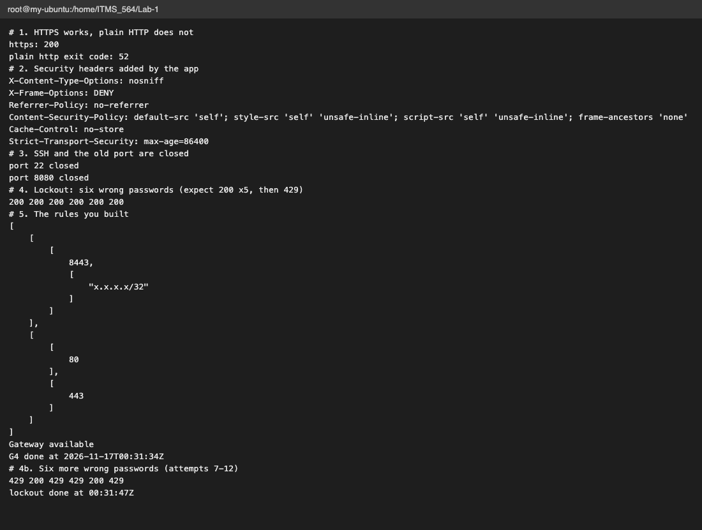

**Q15. Which of the six checks proved encryption in transit, which proved a smaller attack surface, and which proved protection against password guessing?**

- **Encryption:** check 1 (HTTPS only) and check 2 (the security headers).
- **Smaller attack surface:** check 3 (closed ports) and check 5 (the firewall rules).
- **Password guessing:** check 4 (the lockout).

## Part H, G1 to G3: Identity experiments

The dashboard showed all 10 employees, and offboarding emily worked. Onboarding her again was refused, because her old record still exists and reusing the name would mix up two people's history.

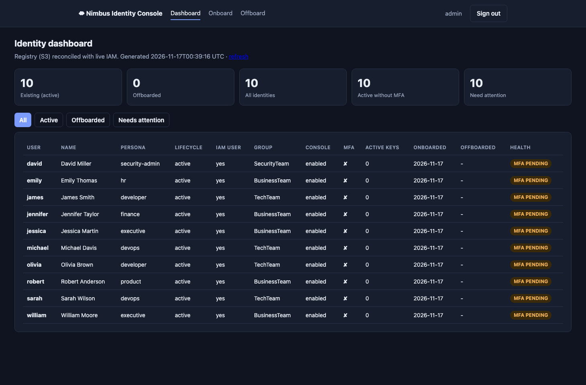
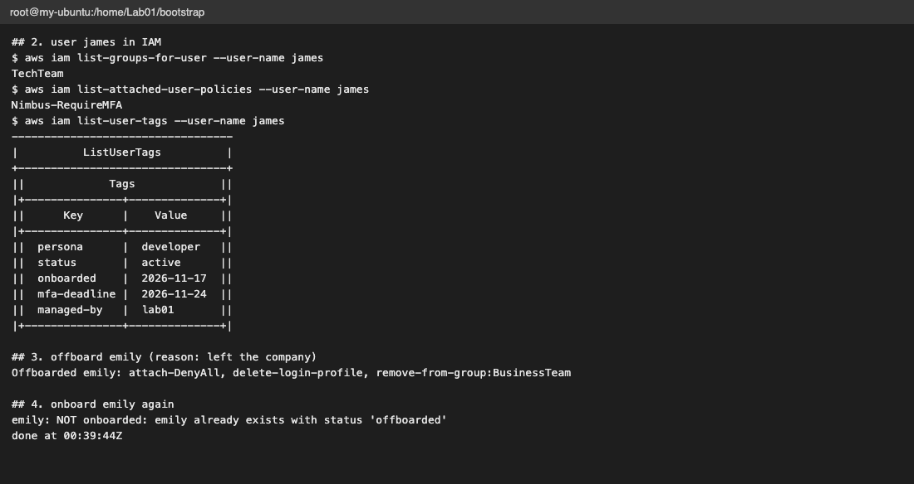
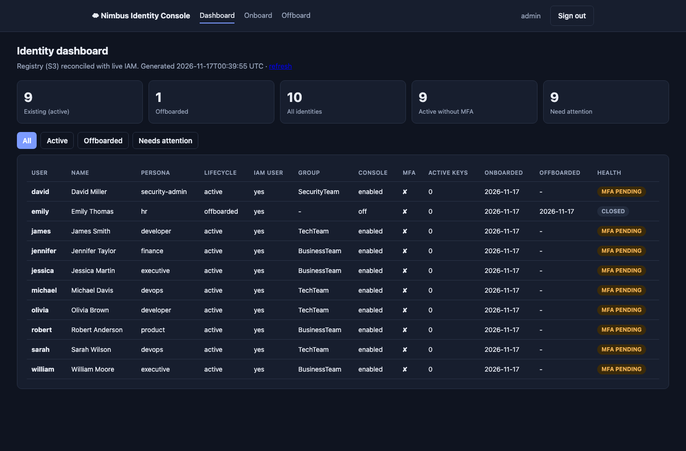
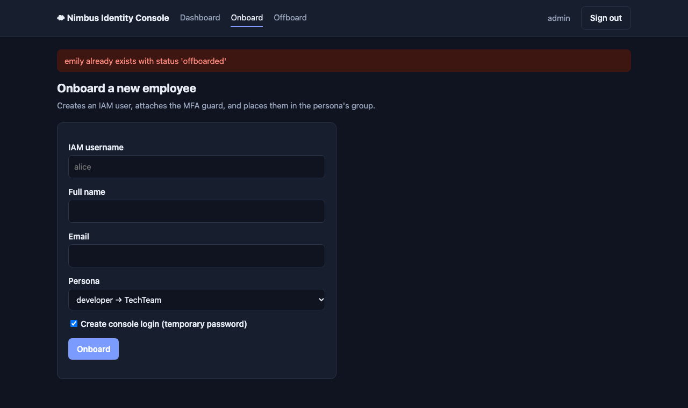

I signed in as james without MFA, then set up his MFA, and he turned OK. william's leftover key was flagged as DRIFT and still blocked by the kill switch. mallory was flagged as UNTRACKED.

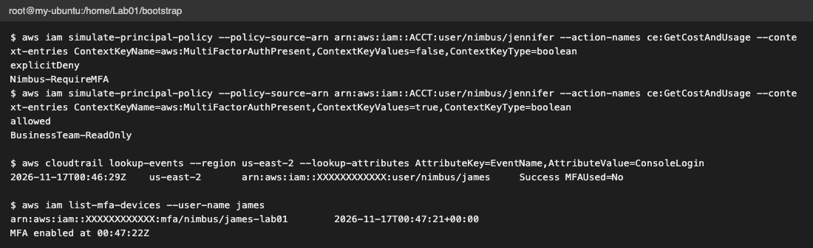
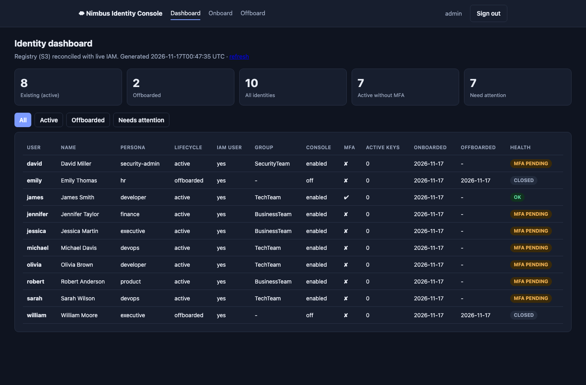
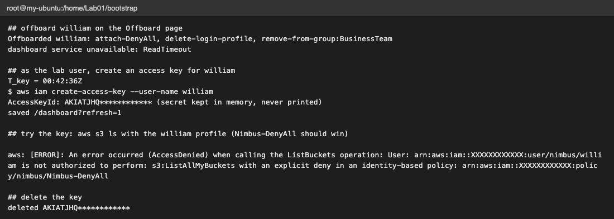
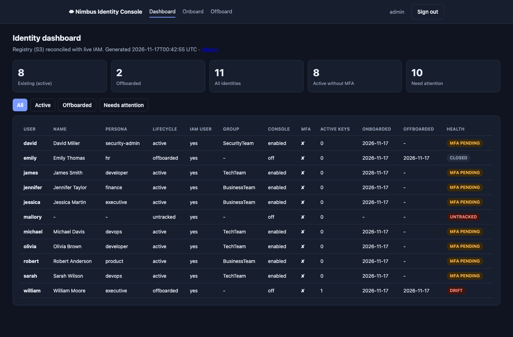
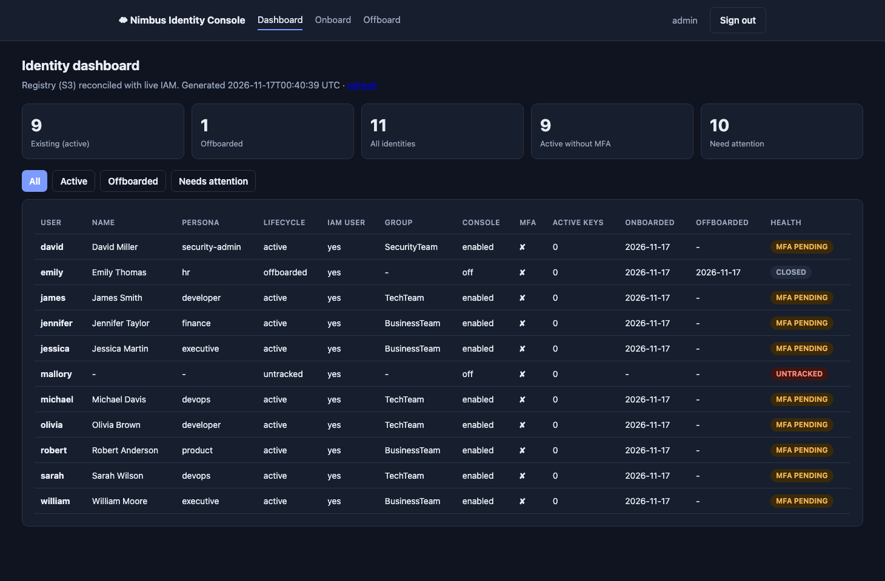
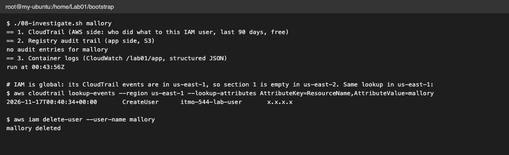

**Q16. Why does the same user and action get denied without MFA and allowed with it? Quote the condition key.**

The MFA guard blocks everything when `"aws:MultiFactorAuthPresent": "false"`. Without MFA the block applies. With MFA it doesn't, so jennifer's normal finance permissions take over.

**Q17. Who created mallory and how did you find out? Why does the audit trail in S3 not show it?**

I did, from my lab user. CloudTrail showed it, but I had to look in us-east-1, because IAM events are recorded there and the investigate script looks in us-east-2. The app's audit trail only knows about things done through the app, and I created mallory straight from the command line.

**Q18 (explore). Replacing IAM users with single sign on. Suppose the company adopts AWS IAM Identity Center with an external identity provider. Which parts of this lab become unnecessary, which still matter (for example the MFA guard, the kill switch and drift detection), and what new risks appear, such as a compromised identity provider?**

I wouldn't need to create IAM users, hand out one-time passwords or attach the MFA guard, because people would sign in through the company login [12]. I'd still need a way to cut someone off fast, a check that the employee list matches who has access, and the logs and alerts. The new risk is that if the company login system gets hacked, the attacker gets into everything at once.

## Part H, G5 and G6: Data proofs and incident drill

Plain HTTP to the bucket was denied, encryption and versioning were on, and rotating the token didn't break anything. No passwords showed up in the logs.

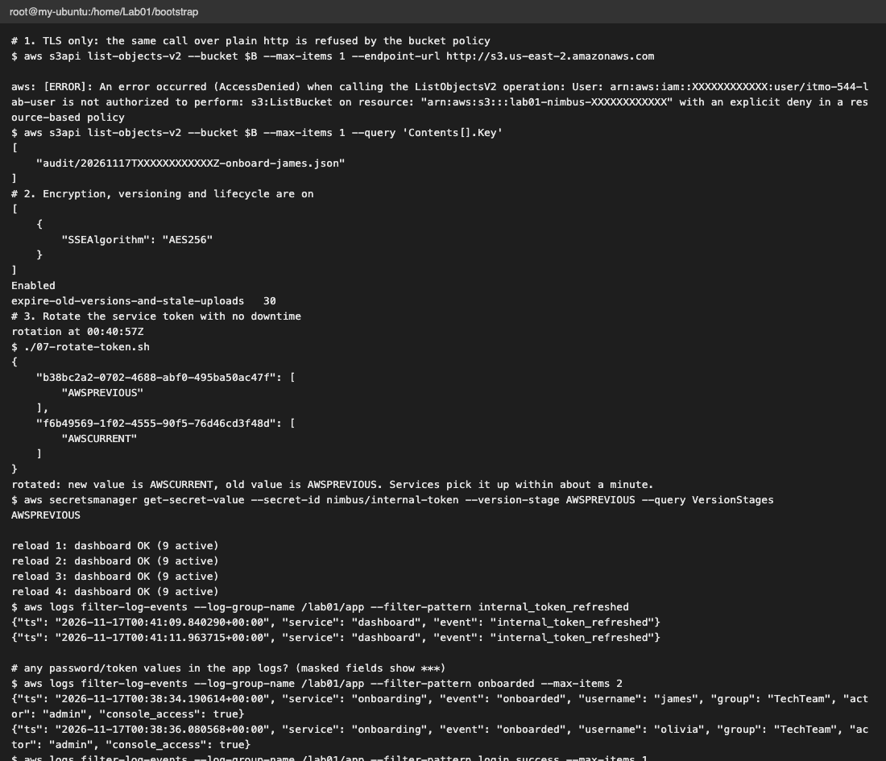

My G6 timeline (UTC, Nov 17):

| Phase | What I did | Time |
|---|---|---|
| Detection | Planted a backdoor key on james | 00:47:55 (no alert arrived) |
| Analysis | Investigate script found who did it and from where | 00:48:24 |
| Containment | Offboarded james, which turned his key off | 00:48:41 |
| Eradication | Deleted the key | 00:48:49 |
| Recovery | Created a replacement account, james2 | 00:48:55 |
| Post incident | Flow logs showed my blocked port scans | 00:48:57 |

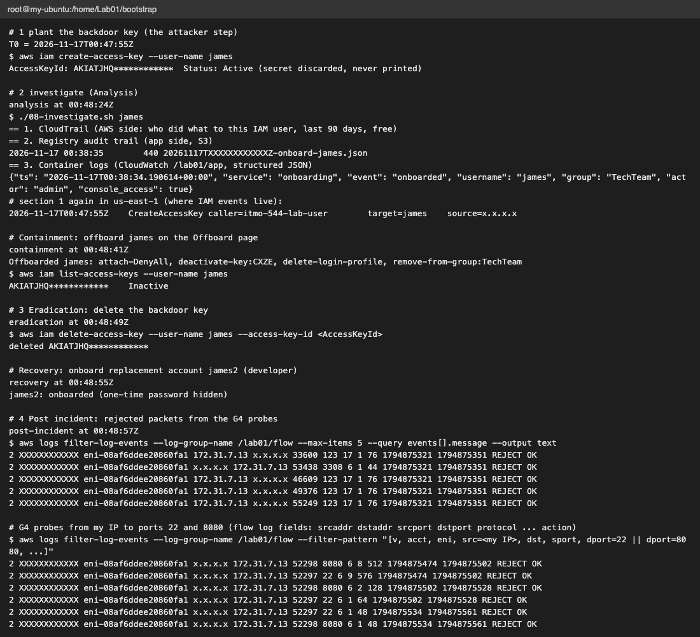
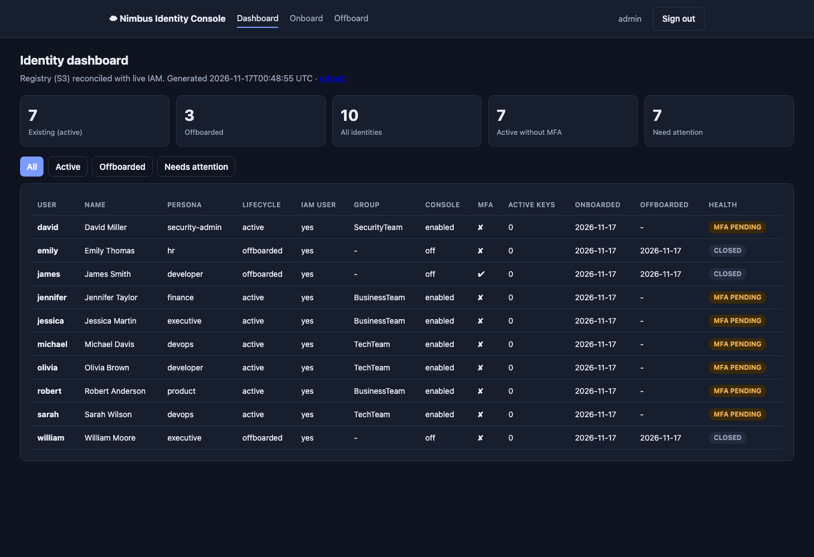

**Q19. Why is a token rotation safe with no restart, and what would break if the services accepted only the current token?**

The services accept both the new token and the previous one for a while, so nothing breaks while they catch up. If they only accepted the new one, requests would fail for up to a minute after each change, and the dashboard would stop working.

**Q20. Which control would have prevented the incident, and which only limited it? Name one more free control you would add.**

Nothing in the lab prevented it, because my lab user could create keys for anyone. Tighter permissions on that user, or requiring MFA for changes like that, would have. The kill switch, the dashboard and the investigate script only limited the damage. The one free control I'd add is recording all regions, so the alerts actually work.

**Q21 (explore). Mapping the drill to a framework. Map the steps of the G6 incident drill to techniques in the MITRE ATT&CK Cloud Matrix (for example persistence through additional cloud credentials). Then map three controls from this lab to a published control set such as the CIS AWS Foundations Benchmark or NIST SP 800-53, and identify one requirement in that set which this lab does not meet.**

In MITRE ATT&CK [13]:
- Using the stolen login is "Valid Accounts: Cloud Accounts" (T1078.004).
- The backdoor key is "Additional Cloud Credentials" (T1098.001).
- Creating mallory is "Create Account: Cloud Account" (T1136.003).

My response followed the NIST incident steps [14]. Against the CIS AWS benchmark [15], the lab meets MFA for console users (1.10), permissions through groups only (1.15) and log file validation (3.2). It doesn't meet "CloudTrail enabled in all regions" (3.1), and that's exactly why my alerts failed.

## Part I: From 10 to 100 People

With 11 users, a full dashboard refresh took about 2.7 seconds.

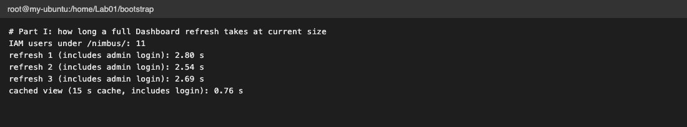

**Q22. Complete the table in your own words: which limit do you hit first in each row, and what do you change?**

| Area | What breaks first | What I'd change |
|---|---|---|
| Permissions | Three groups get too broad as roles grow | Add more specific groups, or move to single sign-on |
| Registry | Listing thousands of files gets slow | Use a small database instead |
| Dashboard | Too many IAM calls, so AWS slows them down | Use the IAM credential report and cache longer |
| Service identity | One hacked container can act as every service | Give each service its own isolated role |
| Sign in | One shared admin password | Each admin gets their own login |
| Logging | One region misses events, and logs pile up | Record all regions into a separate log account |

**Q23 (explore). Controls that even an administrator cannot remove. At company scale you add guardrails above the account. Choose three controls from this lab (for example the trail, the Deny All policy, Block Public Access) and write the Service Control Policy that would protect each one in an AWS Organization. What does an SCP not protect against, and why is the management account treated differently?**

This policy blocks anyone except an emergency role from turning off the trail, editing the kill switch or making buckets public:

```json
{"Version": "2012-10-17", "Statement": [
 {"Effect": "Deny", "Action": ["cloudtrail:StopLogging", "cloudtrail:DeleteTrail"], "Resource": "*",
  "Condition": {"ArnNotLike": {"aws:PrincipalArn": "arn:aws:iam::*:role/BreakGlass"}}},
 {"Effect": "Deny", "Action": ["iam:CreatePolicyVersion", "iam:DeletePolicy"], "Resource": "arn:aws:iam::*:policy/nimbus/Nimbus-DenyAll",
  "Condition": {"ArnNotLike": {"aws:PrincipalArn": "arn:aws:iam::*:role/BreakGlass"}}},
 {"Effect": "Deny", "Action": ["s3:PutBucketPublicAccessBlock", "s3:PutAccountPublicAccessBlock"], "Resource": "*",
  "Condition": {"ArnNotLike": {"aws:PrincipalArn": "arn:aws:iam::*:role/BreakGlass"}}}]}
```

An SCP only takes permissions away, so it doesn't stop someone from misusing access they're still allowed to have. It also doesn't apply to the management account at all, so that account should stay empty and tightly locked [3].

## Part J: Clean Up

Before cleaning up, I checked that the logs hadn't been tampered with, and they passed. Then the cleanup deleted everything, and the final check found nothing left.

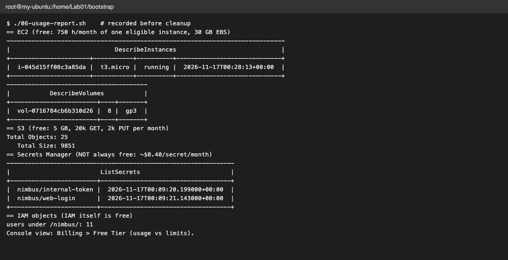
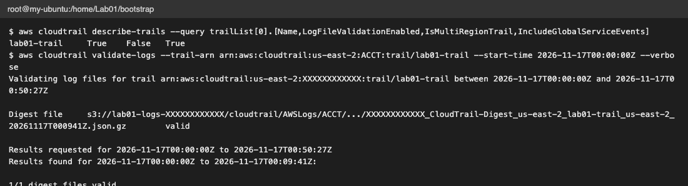
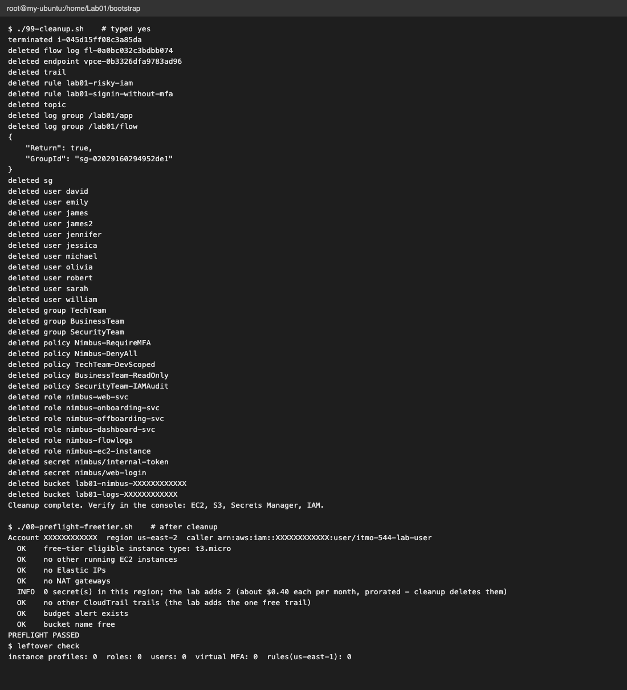

**Q24 (explore). Can you trust the logs? The cleanup script deletes the trail and the log bucket, but in a real company those logs are evidence. The trail has log file validation on. Explain what the digest files prove and how you would verify them with aws cloudtrail validate-logs. Then describe what an attacker with administrator rights could still do to your evidence in this lab, and how a separate log archive account, S3 Object Lock and MFA delete would change the answer.**

The digest files are a signed fingerprint of every log file, so they prove nothing was changed or deleted after it was saved [16]. I ran `aws cloudtrail validate-logs`, and it came back valid. But an admin could still just turn off the trail or delete the whole bucket, which is exactly what my cleanup script did. Validation spots tampering, but it doesn't stop it. Storing logs in a separate account keeps them away from this account's admins. Object Lock stops anyone from deleting them for a set time [17], and MFA delete requires the root user's MFA code to delete anything.

## References

1. AWS. "IAM Access Analyzer policy validation." https://docs.aws.amazon.com/IAM/latest/UserGuide/access-analyzer-policy-validation.html
2. AWS. "Permissions boundaries for IAM entities." https://docs.aws.amazon.com/IAM/latest/UserGuide/access_policies_boundaries.html
3. AWS. "Service control policies (SCPs)." https://docs.aws.amazon.com/organizations/latest/userguide/orgs_manage_policies_scps.html
4. AWS. "Key policies in AWS KMS." https://docs.aws.amazon.com/kms/latest/developerguide/key-policies.html
5. AWS. "Configure the Instance Metadata Service options." https://docs.aws.amazon.com/AWSEC2/latest/UserGuide/configuring-instance-metadata-options.html
6. AWS. "Amazon ECS task IAM role." https://docs.aws.amazon.com/AmazonECS/latest/developerguide/task-iam-roles.html
7. AWS. "EKS Pod Identity." https://docs.aws.amazon.com/eks/latest/userguide/pod-identities.html
8. AWS. "Receiving events from AWS services using AWS CloudTrail." https://docs.aws.amazon.com/eventbridge/latest/userguide/eb-service-event-cloudtrail.html
9. AWS. "GuardDuty IAM finding types." https://docs.aws.amazon.com/guardduty/latest/ug/guardduty_finding-types-iam.html
10. IETF. *RFC 6797: HTTP Strict Transport Security (HSTS)*. 2012.
11. IETF. *RFC 9162: Certificate Transparency Version 2.0*. 2021.
12. AWS. "What is IAM Identity Center?" https://docs.aws.amazon.com/singlesignon/latest/userguide/what-is.html
13. MITRE. "ATT&CK Matrix for Enterprise: Cloud." https://attack.mitre.org/matrices/enterprise/cloud/
14. NIST. *SP 800-61 Rev. 3: Incident Response Recommendations and Considerations for Cybersecurity Risk Management*. 2025.
15. Center for Internet Security. *CIS Amazon Web Services Foundations Benchmark v3.0.0*. 2024.
16. AWS. "Validating CloudTrail log file integrity." https://docs.aws.amazon.com/awscloudtrail/latest/userguide/cloudtrail-log-file-validation-intro.html
17. AWS. "Locking objects with Object Lock." https://docs.aws.amazon.com/AmazonS3/latest/userguide/object-lock.html
